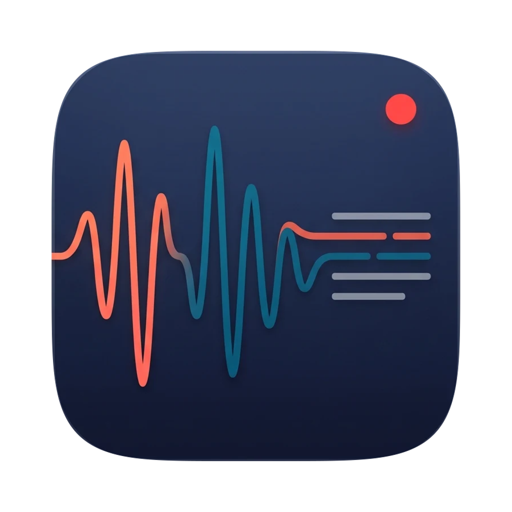

<!-- Icon: add assets/icon.png (square PNG, 512 to 2048 px, under 2 MB) and this line will show it. -->
<p align="center"></p>

# call-rec-transcript

Record a call on your Mac, transcribe it **on the Mac**, and get a clear note from Claude.

No bot joins the meeting and no audio leaves your computer. Your microphone and the Mac's
audio (the other people) are recorded on two separate tracks, so the transcript knows who
said what without any guessing. Then Claude writes a short note: decisions, commitments
(who, what, by when), numbers and dates, open questions, things to double-check.

It is a [Claude Code](https://code.claude.com) plugin: Claude helps you set it up, and after
the call it opens the transcript and the note and helps you with the follow-up.

## What you get after each call

- `transcript.md`: the full transcript, with each line labelled `YOU` or `OTHERS`
  (`TU` / `ALTRI` for calls in Italian) and a timestamp;
- a note in Markdown in your notes folder (an Obsidian vault works);
- a PDF of the note, easy to read on a phone (optional; it can go to iCloud Drive);
- the audio, compressed to about 20 MB per hour per track.

## Requirements

- A Mac with **Apple Silicon** and **macOS 14.4 or later** (system-audio capture uses Core
  Audio process taps). Intel Macs may work but are untested and slow for whisper.
- Xcode command line tools: `xcode-select --install`
- [Homebrew](https://brew.sh), then `brew install ffmpeg whisper-cpp`
- A whisper model, about 1.6 GB (`get-model.sh` downloads it)
- For the notes: [Claude Code](https://code.claude.com) logged in from the Terminal, or an
  `ANTHROPIC_API_KEY`
- For the PDF (optional): Google Chrome, Chromium, Microsoft Edge or Brave

## Install

In Claude Code:

```
/plugin marketplace add maraplale/call-rec-transcript
/plugin install call-rec-transcript@call-rec-transcript
```

Then ask Claude: *"set up the call recorder"*. It checks what is missing, asks before
installing or downloading anything, writes your settings and builds the app.

## First setup by hand

From the plugin's `recorder/` folder (or a clone of this repository):

```bash
./check-setup.sh          # what is there and what is missing
./get-model.sh            # whisper large-v3-turbo, ~1.6 GB, into ~/.cache/whisper-cpp
./build.sh                # builds Call Recorder.app into ~/Applications/Call Recorder/
```

Then, **in your own Terminal**:

```bash
"$HOME/Applications/Call Recorder/setup-permissions.sh"
```

Two macOS dialogs appear; allow both, once:

- **Microphone**: your voice;
- **Screen & System Audio Recording**: the other people's audio. macOS files system-audio
  capture under this heading; nothing is recorded from the screen.

Why `~/Applications/Call Recorder/`: the plugin folder is replaced at every update, while
macOS ties the permissions to the app. `build.sh` puts the app, the scripts and the two
double-click launchers there. After a plugin update, run `build.sh` again: it refreshes the
scripts and recompiles only if the recorder's source changed (then run
`setup-permissions.sh` again, because a new build has a new fingerprint).

## Recording a call

Double-click **Record call** in `~/Applications/Call Recorder/` (drag it to the Dock if you
like). It asks what the call is about, then records. Press **ENTER** to stop. The rest is
automatic: transcription, note, PDF, compression. At the end it offers to open the summary.

Or from your Terminal:

```bash
"$HOME/Applications/Call Recorder/rec" "client kickoff"
```

| option | what it does |
|---|---|
| `--speakerphone` | phone on speakerphone next to the Mac (see below) |
| `--lang it` / `--lang en` | language of the call (default `auto`) |
| `--no-note` | record and transcribe, no Claude |
| `--keep-wav` | keep the original WAV files (about 2 GB per hour) |
| `--resume last` or `--resume <folder>` | transcribe again and rewrite the note of a recording already made |
| `--keep-echo`, `--keep-hallucinations` | turn off the two transcript filters (below) |

Italian aliases work too: `--viva-voce`, `--lingua`, `--senza-nota`, `--tieni-wav`,
`--riprendi`, `--tieni-eco`, `--tieni-inventate`.

At start it plays a quiet "tink" and checks that the others' audio really arrives. If it
does not, it says so in red right away, not after the call.

**Start it yourself**, from your Terminal or with a double-click. macOS gives the
system-audio permission to whoever *started* the recorder: if another program starts it (an
agent, an automation, Claude itself), the OTHERS track comes out silent with no error. That
is why Claude never starts the recording for you; it tells you how.

## Speakerphone calls

Calls made **on the phone** do not go through the Mac, so the OTHERS track would be
silent. Put the phone on speakerphone next to the Mac's microphone and use
**Record speakerphone** (or `rec --speakerphone "title"`).

What changes:

- both voices end up on the same track, so the transcript **does not say who speaks**: it
  starts a new paragraph at each pause, and Claude works out who said what from the
  context when it writes the note (if it is not clear, the note says so);
- it checks that the microphone started, instead of checking the Mac's audio;
- before transcribing it raises the quiet parts (`dynaudnorm`): the voice coming from the
  phone is much quieter than yours.

Tips: phone 20-40 cm from the microphone, screen up, volume high but not at the maximum (it
distorts); no music or TV. No headphones here: the other voice must come out of the phone
so the microphone can hear it.

## Settings

`~/.config/call-rec-transcript/config`, one `KEY=value` per line (`build.sh` creates a
commented one; see `recorder/config.example`). Environment variables with the same name win.

| key | default | |
|---|---|---|
| `CRT_NOTES_DIR` | `~/Documents/Call Notes` | where notes go; can be an Obsidian folder |
| `CRT_RECORDINGS_DIR` | `~/Documents/Call Notes/recordings` | one folder per call (audio, transcript, log) |
| `CRT_TRANSCRIPTS_DIR` | `<notes>/transcripts` | copy of each transcript; `off` = no copy |
| `CRT_PDF_DIR` | the notes folder | `off` = no PDF; e.g. `~/Library/Mobile Documents/com~apple~CloudDocs/Call Notes` for iCloud Drive |
| `CRT_LANG` | `auto` | language of the calls: `auto`, `it`, `en`, ... |
| `CRT_UI_LANG` | `auto` | language of the messages: `en` or `it` (auto follows the Mac) |
| `CRT_USER_NAME` | empty | your name, used in the note |
| `CRT_NOTE` | `on` | write a note with Claude |
| `CRT_NOTE_ENGINE` | `auto` | `api` if `ANTHROPIC_API_KEY` is set, else the `claude` CLI; or force `api` / `cli` |
| `CRT_NOTE_MODEL` | `claude-sonnet-5-5` | model for the API path |
| `CRT_KEEP_WAV` | `off` | keep the WAV files instead of compressing |
| `CRT_FRONTMATTER` | `on` | YAML header at the top of the note |
| `CRT_INSTALL_DIR` | `~/Applications/Call Recorder` | where `build.sh` installs the app and launchers |
| `CRT_MODEL_DIR` | `~/.cache/whisper-cpp` | whisper models |
| `CRT_WHISPER_THREADS` | automatic | threads for whisper |
| `CRT_CHROME` | automatic | browser used for the PDF |

The last recording is recorded in `~/.config/call-rec-transcript/last-recording` (folder,
transcript, note, PDF), so you, or Claude, can always find it.

## Privacy

- **The audio never leaves your Mac.** Recording and transcription happen locally.
- Only the **text** of the transcript is sent to Claude, to write the note, and only if
  notes are on (`CRT_NOTE=off` turns them off). Through the `claude` CLI it runs with no
  tools and is not saved as a session.
- Nothing is uploaded anywhere else. Where your notes and PDFs are synced (iCloud, Obsidian
  Sync...) is your choice.

## Tell people you are recording

Always tell the other people that you are recording, as soon as the call starts, and ask if
it is OK; if someone says no, stop (ENTER) and take notes by hand. The launchers remind you
every time. A call recording is personal data (in the EU it falls under the GDPR) and the
rules on recording calls differ by country. This is not legal advice.

## How it works

| piece | what it does |
|---|---|
| `recorder/src/recorder.swift` | Core Audio process tap (system audio) + AVAudioEngine (microphone), writes two WAV files |
| `recorder/build.sh` | compiles an ad-hoc signed `.app` bundle: without a bundle macOS does not know whom to give the permissions to |
| `recorder/transcribe.py` | ffmpeg → 16 kHz mono → cuts the silences → whisper-cli → merges the two tracks by time |
| `recorder/note.py` | asks Claude for the note (API or `claude` CLI) |
| `recorder/pdf.py` | lays the note out as an A4 PDF with a headless browser |
| `recorder/rec` | does it all in order |
| `Record call.command`, `Record speakerphone.command` | the double-click launchers |
| `setup-permissions.sh`, `check-setup.sh`, `diagnose-tap.sh`, `self-test.sh`, `get-model.sh` | setup and troubleshooting |
| `skills/call-rec-transcript/SKILL.md` | what Claude knows about all this |

The trick that matters: **two separate tracks**. The microphone is you, the system audio is
the others. Knowing who speaks comes for free, without diarization.

**Speaker echo.** With speakers on, the microphone hears the others too, and the same
sentence ends up on both tracks, mangled on yours. The transcript drops a `YOU` line that
looks too much like a nearby `OTHERS` line. Headphones are still better: if you talk over
each other, the echo covers your voice and that part is really lost.

**Phrases whisper makes up.** On sounds without words (the start "tink", a notification,
silence) whisper writes sentences nobody said, learned from video subtitles: "Thank you.",
"Thanks for watching", "Grazie.", subtitle credits. They are removed: subtitle credits
wherever they appear, courtesy formulas only when they are the whole line ("OK, thanks, talk
on Friday" stays).

**Costs.** Transcription is free and local (about 1 minute of computing per 10 minutes of
audio on Apple Silicon). The note is one Claude request per call.

### Works with

The tap is attached to the Mac's audio output, not to a specific app, so it works with
Zoom, Google Meet (in the browser), Microsoft Teams, WhatsApp Desktop, FaceTime, Slack
huddles, Discord, Webex, and iPhone calls answered on the Mac (Continuity). It works with
speakers, AirPods, USB headsets and audio interfaces. In-person meetings: microphone only.
Calls on the phone itself: use speakerphone mode. DRM-protected audio (Netflix, Apple Music)
is silenced by macOS.

## Known limits

- If three or more people are all in the system audio, they are all `OTHERS`.
- Whisper transcribes in blocks: the merge timestamps are good, not exact to the second.
- Whisper gets proper names wrong; the note usually fixes them from context.
- No graphical interface: Terminal and two launchers.
- The app is signed ad-hoc: every new build needs the permissions again
  (`setup-permissions.sh`).
- First run: the recorder waits for the permission dialog; after 10 seconds it tells you so.
  If the dialog is gone, give the permission in System Settings ▸ Privacy & Security.
- Start it from your own Terminal or with a double-click (see above).
- Tested on Apple Silicon only.

## Credits

- [whisper.cpp](https://github.com/ggml-org/whisper.cpp) by Georgi Gerganov and contributors
  (MIT), with OpenAI's Whisper models (MIT). Installed separately with Homebrew.
- [FFmpeg](https://ffmpeg.org) (LGPL/GPL), installed separately with Homebrew; not bundled.
- Notes written by [Claude](https://www.anthropic.com/claude).

## License

MIT, see [LICENSE](LICENSE).

---

## In italiano

**call-rec-transcript** registra una call sul Mac, la trascrive **sul Mac** e chiede a
Claude una nota chiara: decisioni, impegni (chi, cosa, entro quando), numeri e date, punti
aperti, cose da verificare. Nessun bot entra in riunione e nessun audio esce dal computer:
il tuo microfono e l'audio del Mac (gli altri) finiscono su due tracce separate, quindi la
trascrizione sa chi ha detto cosa (`TU` / `ALTRI`).

**Installazione**, in Claude Code:

```
/plugin marketplace add maraplale/call-rec-transcript
/plugin install call-rec-transcript@call-rec-transcript
```

Poi chiedi a Claude *«configura il registratore di call»*: controlla cosa manca (Mac Apple
Silicon con macOS 14.4 o successivo, strumenti da riga di comando di Xcode, `ffmpeg`,
`whisper-cpp`, il modello large-v3-turbo da circa 1,6 GB), chiede prima di installare o
scaricare, scrive le impostazioni e compila l'app in `~/Applications/Call Recorder/`.
Poi, **dal tuo Terminale**, lanci una volta `setup-permissions.sh` e dai i due permessi:
Microfono e Registrazione schermo e audio di sistema (non registra lo schermo, solo l'audio).

**Per registrare**: doppio clic su **Record call** (o **Record speakerphone** per le
telefonate fatte dal cellulare in viva voce accanto al Mac), oppure dal Terminale
`"$HOME/Applications/Call Recorder/rec" "titolo"`. **INVIO** per fermare. Le opzioni
hanno anche il nome italiano: `--viva-voce`, `--lingua it`, `--senza-nota`, `--tieni-wav`,
`--riprendi`. I messaggi escono in italiano se il Mac è in italiano (o con `CRT_UI_LANG=it`).

**Va avviato da te**, dal Terminale o col doppio clic: macOS dà il permesso dell'audio di
sistema a chi avvia il registratore, e se lo avvia un altro programma (anche Claude) la
traccia degli altri esce muta senza errori. Per questo Claude non avvia mai la registrazione:
ti dice come farlo.

**Privacy**: l'audio non esce mai dal Mac. A Claude va solo il testo della trascrizione,
per scrivere la nota, e solo se le note sono attive (`CRT_NOTE=off` le spegne).

**Avvisa sempre** chi è in call che stai registrando, appena inizia, e chiedi se va bene;
se dice di no, ferma e prendi appunti a mano. Una registrazione è un dato personale (nell'UE
vale il GDPR) e le regole cambiano da paese a paese. Questo non è un parere legale.
